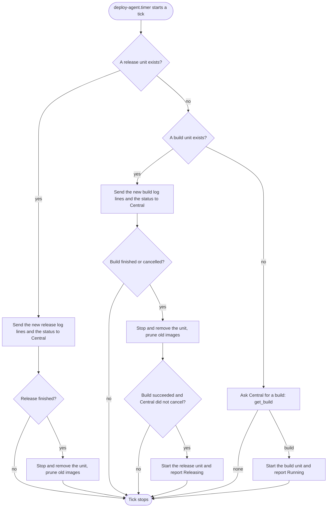
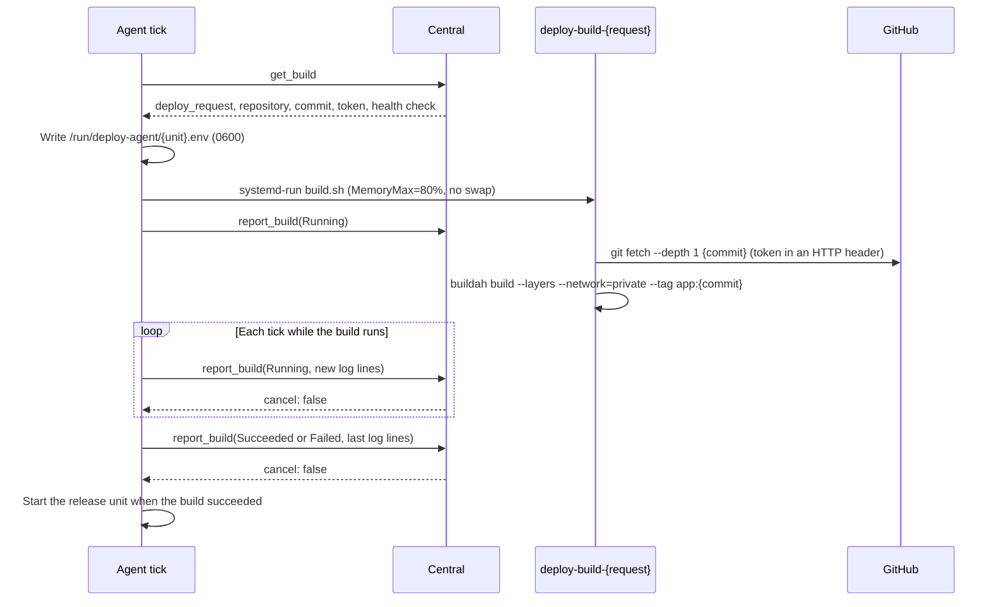
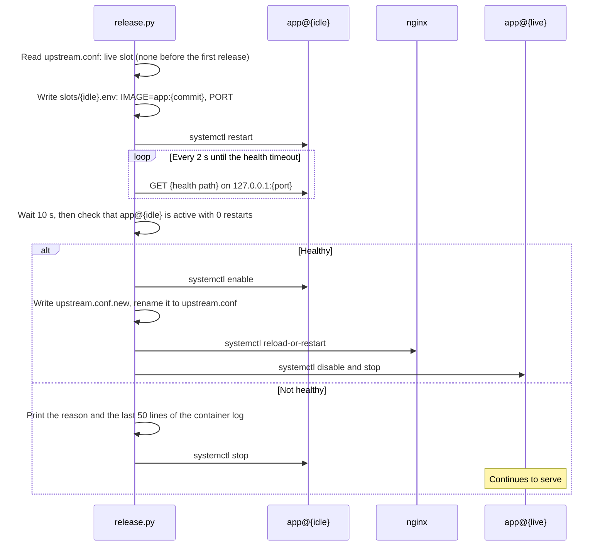
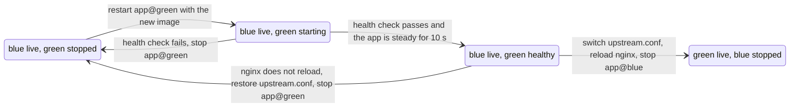
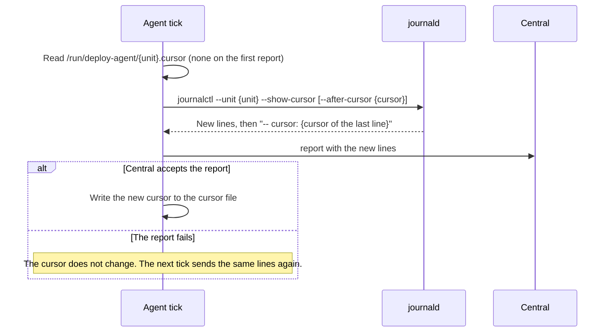

# Deploy agent

## Purpose

The deploy agent runs on each push-to-deploy VM. It builds the commit that Central sends, and it releases the new image with a blue/green switch. The live app continues to serve until the new container is healthy. The agent only reports to Central. Central does not connect to the VM.

The deploy image installs this folder at `/usr/local/lib/deploy-agent/build_agent`. See `cargo/image_builder/doctype/deploy_image/deploy_image.py` for the full list of files that the image copies.

## What runs on the VM

```text
                 Central's regional proxy (TLS, the app's domain)
                                  │ :80
┌─────────────────────────────────▼──────────────────────────────────────┐
│ VM                         nginx (listen 80)                           │
│                                  │                                     │
│              upstream app: include /var/lib/deploy-agent/upstream.conf │
│              (one line: server 127.0.0.1:<port of the live slot>;)     │
│                                  │                                     │
│                   live: 8001 ┌───┴───┐ live: 8002                      │
│                              ▼       ▼                                 │
│                 127.0.0.1:8001       127.0.0.1:8002                    │
│                   app@blue             app@green                       │
│              (podman, app:<commit>) (podman, app:<commit>)             │
│                                                                        │
│ release.py starts the new commit in the idle slot.                     │
│ Healthy: upstream.conf names the new slot, then the old slot stops.    │
│ Not healthy: the new slot stops. upstream.conf does not change.        │
│ nginx does not reload: upstream.conf names the old slot again, or      │
│ release.py deletes it when no slot was live. The new slot stops.       │
│                                                                        │
│ deploy-agent.timer ─► deploy-agent.service (one tick, then it stops)   │
│                         ├─► deploy-build-<request>.service  (build.sh) │
│                         └─► release-build-<request>.service (release)  │
│                                                                        │
│ metadata-block.service: nftables keeps 169.254.169.254 from containers │
└────────────────────────────────────────────────────────────────────────┘
```

| Unit or file | What it does |
|---|---|
| `deploy-agent.timer` | Starts one tick 10 to 20 seconds after the last tick stops. Two ticks never overlap. |
| `deploy-agent.service` | Runs `python3 -m build_agent` once. It does one step, then it stops. |
| `deploy-build-<request>.service` | A transient unit that runs `build.sh`. The agent starts it with `systemd-run`, so the build continues after the tick stops. |
| `release-build-<request>.service` | A transient unit that runs `release.py`. It switches traffic to the new slot. |
| `app@blue`, `app@green` | The two app slots. Each slot runs one container on its own port: blue on 8001, green on 8002. |
| `nginx` | The only public port, 80. It sends traffic to the slot that `upstream.conf` names. |
| `metadata-block.service` | Loads `metadata-block.nft` before the network starts. |
| `/etc/update-motd.d/60-deploy-app` | `motd.sh`. At each SSH login, it shows the live slot and the commands to open a shell in the app, read its output, and read the build and release logs. |
| `/var/lib/deploy-agent/upstream.conf` | The one record of the live slot. |
| `/var/lib/deploy-agent/slots/<slot>.env` | The image, port, and Deploy Request of each slot. |
| `/run/deploy-agent/<unit>.env` | The environment of one build or release unit. Only root can read it. |
| `/run/deploy-agent/<unit>.cursor` | The journal cursor of the last log line that Central accepted. |

## One tick

Each tick does one step and then stops. A release has priority over a build. A build has priority over a new build.



The agent keeps no state between ticks. It finds its work from the systemd units that exist. If the agent restarts, the next tick continues from the same point.

## Build



- **Source:** `build.sh` fetches only the commit. The GitHub token goes in an HTTP header through `GIT_CONFIG_*`. The token is not in the clone's config or in the log.
- **Image:** Buildah finds the `Containerfile` or `Dockerfile` itself. Central checked before the build that the commit has one. The image tag is `app:<commit>`.
- **Network:** `--network=private` sends the `RUN` steps through the forward path. There, `metadata-block` drops traffic to the metadata service.
- **Memory:** The build unit can use 80% of the VM memory and no swap. If the build uses more, the kernel stops only the build. The live app continues to serve. The last report then adds a line that tells the user to use a larger VM.
- **Cancel:** When a newer push supersedes the build, Central replies `cancel: true`. The agent then stops the build unit.
- **Images:** When a unit is removed, the agent keeps the newest app image and the live image, and removes the other images. It then removes the layers that no image uses.

## Release: the blue/green switch

The release starts the new image in the idle slot. It moves traffic only when the new container is healthy. If the new container fails, the old container continues to serve and nothing changes for users.



### How the slots change

The example shows a deploy where blue is live and green gets the new commit.



The next deploy does the same steps with the colors reversed.

### Health check

| `health.path` in `frappe_cloud_deploy.toml` | The new container is ready when |
|---|---|
| Set, for example `/health` | `GET <path>` returns a 2xx status. A redirect is not followed. |
| Not set | Any HTTP response comes back on `/`. |

The agent checks every 2 seconds until `health.timeout` (default 60 s, maximum 600 s). After the first good response, the agent waits 10 seconds. The container must still be active and must have 0 restarts. This step finds an app that answers once and then stops.

The app must listen on the port in `$PORT`. The container publishes this port only on `127.0.0.1`, so only nginx can reach it.

### Why the switch is safe

- **One record:** `upstream.conf` is the only record of the live slot. `release.py` reads it to find the live slot and the idle slot. A release that stops halfway is safe to run again.
- **Atomic write:** `release.py` writes `upstream.conf.new` and renames it. nginx never reads a half-written file.
- **Reload failure:** If nginx does not reload, `release.py` puts back the old `upstream.conf` and stops the new slot. The live app does not change.
- **First release:** Before the first release, `upstream.conf` does not exist. nginx then uses a placeholder server that is marked `down`.
- **Reboot:** `systemctl enable` marks the new slot to start at boot. The old slot is disabled. After a reboot, only the live slot starts.

## Reports to Central

The agent calls Central's `central.deploy.api` methods. Each call has the `X-Deploy-Agent-Token` header.

| Call | When | Status values |
|---|---|---|
| `get_build` | No build or release unit exists | None |
| `report_build` | Each tick while a build unit exists | `Running`, `Succeeded`, `Failed` |
| `report_deployment_status` | Each tick while a release unit exists | `Releasing`, `Live`, `Failed` |

Central fails the deploy in these conditions:

| Condition | Limit |
|---|---|
| The agent does not report on a build or a release | 5 minutes |
| A build runs too long | 60 minutes |
| A release runs too long | 15 minutes |

## Logs

Each report sends only the log lines that Central does not have yet. Central adds them to the end of the deploy's log.



- **Cursor:** A journal cursor identifies one journal entry. `--after-cursor` returns only the entries after it.
- **Order:** The agent writes the cursor only after Central accepts the report. A failed report does not lose lines. If Central saves the lines but its reply does not arrive, the next report sends those lines again.
- **Burst limit:** If a unit writes more than 256 KiB between two ticks, the report sends the newest 256 KiB. A line `... earlier output skipped ...` comes first.
- **Cleanup:** The agent deletes the cursor file when it removes the unit.

## Credential and metadata

Central puts the agent's credential in the VM's guest metadata, under the key `deploy-agent`. The value is JSON with `central_url` and `credential`. The agent reads it once in each tick:

1. `PUT http://169.254.169.254/latest/api/token` gets a session token.
2. `GET http://169.254.169.254/latest/meta-data/attributes/deploy-agent` gets the value.

User code must not read this credential. User code runs only in containers and in the `RUN` steps of a build, and both reach the network through podman's bridge. `metadata-block.nft` loads before the network starts and has one rule:

| Chain | Rule | Stops |
|---|---|---|
| `forward` | Drop traffic from a `podman*` interface to `169.254.169.254` | Containers and the `RUN` steps of a build |

Processes on the host can read the metadata. The agent reads the credential as root. sshd reads the SSH keys from the metadata as `nobody`, through `atlas-guest-agent authorized-keys`. A block on the host would stop SSH and the web console. `deploy-agent.service` and `app@.service` require `metadata-block.service`. If the block does not load, no build and no app starts.

## Known limits

- **Reboot during a build:** The build is lost. Central sees no reports and fails the deploy after 5 minutes.
- **Reboot during a release, before the switch:** The release is lost. The old slot continues to serve. Central fails the deploy after 5 minutes.
- **Reboot after the switch, before the last report:** The VM serves the new commit, but Central can show the deploy as failed.
- **Central unavailable for more than 5 minutes during a build:** Central fails the deploy, although the build can continue on the VM.
- **journald rate limit:** journald drops output above its rate limit for each service. A very noisy build can lose log lines before the agent reads them.
- **Disk writes:** Each start of a slot is a new container from the image. A crash or a reboot loses data that the app writes outside a mount.

## Operation

| To see | Run on the VM |
|---|---|
| The last ticks of the agent | `journalctl --unit deploy-agent.service --since -10min` |
| A build or a release in progress | `systemctl list-units 'deploy-build-*' 'release-build-*'` |
| The log of a build or a release | `journalctl --unit deploy-build-<request>.service` |
| The live slot | `cat /var/lib/deploy-agent/upstream.conf` |
| The image of each slot | `cat /var/lib/deploy-agent/slots/*.env` |
| The app log | `journalctl --unit app@blue` or `journalctl --unit app@green` |
| The metadata block | `nft list table inet deploy_agent` |
